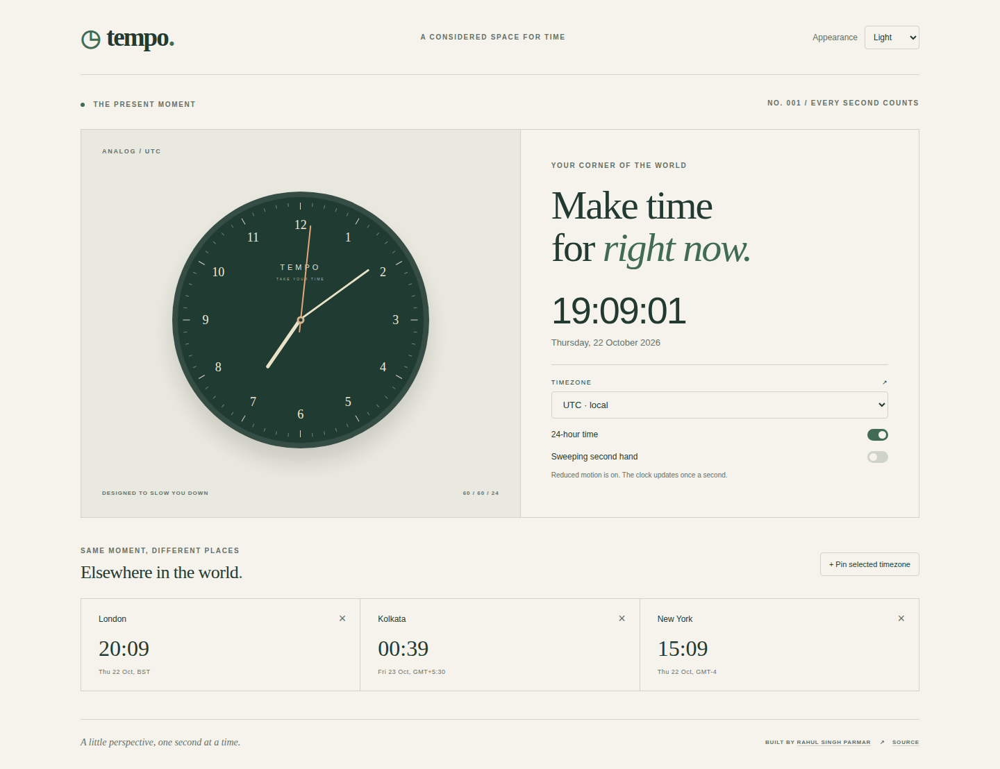
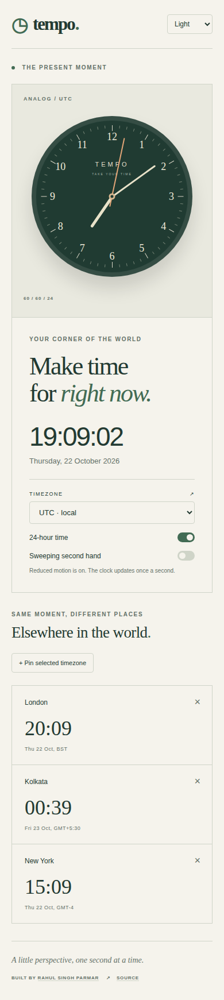

# Tempo — a considered space for time

[Live demo](https://rahulsinghparmar.github.io/css_clock/) · [Frontend checks](https://github.com/RahulSinghParmar/css_clock/actions/workflows/quality.yml) · [Design case study](docs/CASE-STUDY.md)

A responsive analog clock and timezone dashboard built with HTML, CSS and vanilla JavaScript. A warm editorial layout, a CSS-built dial and precise timezone logic turn the original clock experiment into a frontend showcase.



## Features

- Analog and digital time, with local timezone detection and an IANA timezone selector.
- Light, dark and system appearance; 12/24-hour display and optional sweeping seconds.
- Pin up to four world clocks, with dates and timezone abbreviations.
- Daylight saving and fractional offsets handled by the browser's Intl timezone database.
- Saved preferences with validation and graceful fallback when local storage is blocked.
- Reduced motion uses discrete ticks. Hidden tabs stop scheduling updates.
- Responsive layouts, semantic controls, visible keyboard focus and a skip link. Time updates are not announced every second to screen readers.

## Screenshots



These are captures of the implemented app, generated by the browser showcase test. Times reflect the capture moment; mobile images show the full scrollable page.

## Run locally

```sh
npm ci
npm start
```

Open http://127.0.0.1:4173. Node.js 22.13+ is used for tooling only. The deployed app is static and requests no third-party fonts or scripts. Serve the files over HTTP because JavaScript uses ES modules.

## Verify

```sh
npm run lint
npm run format:check
npm test
npx playwright install chromium firefox webkit
npm run test:e2e
```

Unit tests cover hand angles, midnight, fractional offsets, DST and storage failures. Browser tests exercise timezone changes, appearance, clock pinning, persistence and reduced motion in Chromium, Firefox, WebKit and a mobile Chromium viewport. Browser emulation does not replace testing on physical phones or with assistive technology.

## Implementation

`time.js` contains pure timezone and hand-angle functions. `clock.js` manages state, scheduling and DOM updates. `tokens.css` defines theme colors; `style.css` defines layout and the proportional dial. Ticking uses a timeout aligned to the next second; sweeping uses elapsed wall-clock time and requestAnimationFrame. No interval accumulates clock drift. Accuracy follows the device clock and browser timezone data, not a remote time server.

The historical `watch.html` link redirects to the single themed page. Old image/document assets remain as historical material; the new dial needs neither. See [contributing](CONTRIBUTING.md) and [security](SECURITY.md).

## Deployment

GitHub Actions runs checks before publishing an explicit list of public assets to GitHub Pages. Repository settings must use GitHub Actions as the Pages source. Pull requests run tests without deploying.

## Credits and license

Created by [Rahul Singh Parmar](https://github.com/RahulSinghParmar). The original 2022 experiment remains in Git history. The new HTML/CSS/JavaScript implementation is [MIT licensed](LICENSE); the license does not assert rights over historical image/document assets.
